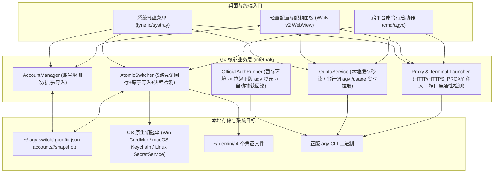
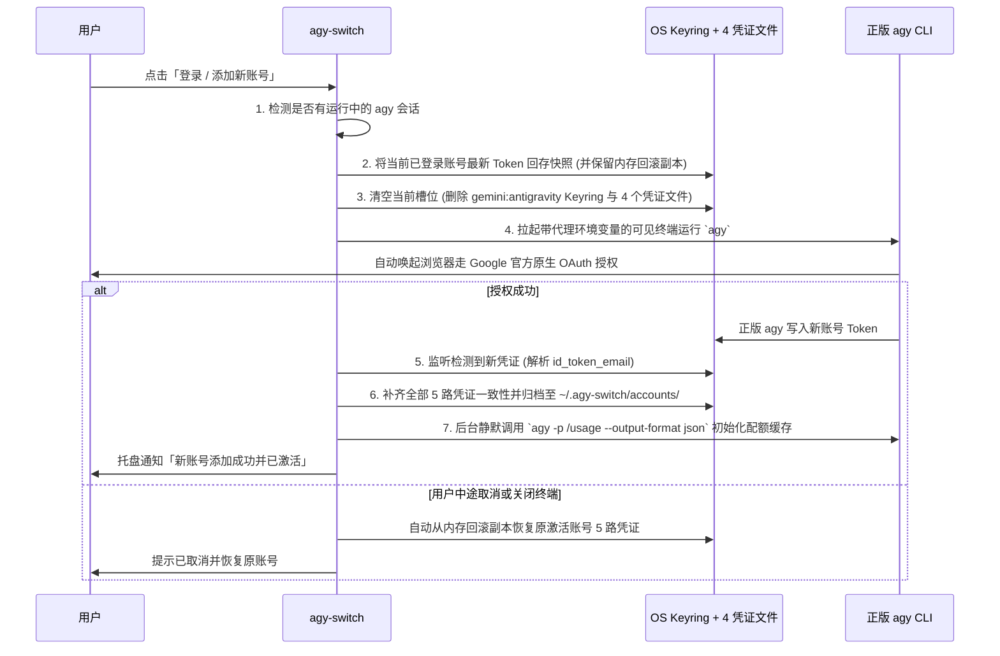

# `agy-switch` 跨平台账号切换与代理启动器 — 技术规格与实施计划 (Spec & Plan)

## 1. 目标概述 (Goal Description)

构建一个轻量、跨平台（Windows / macOS / Linux）、遵循**最高账号安全原则**的桌面托盘小工具 **`agy-switch`** 及其配套命令行启动器 **`agyc`**，源码位于 `D:\a\agy-switch`，用于完整替代现有的 **Antigravity Tools (`atool`)** 与 PowerShell Profile 中的 476 行脚本逻辑。

核心目标：
1. **常驻系统托盘（右下角 / macOS 顶部状态栏）**：平时隐藏不占任务栏，右键菜单即可 **一键切号、查看余量摘要、开关/切换代理、一键拉起带代理的 `agy` 终端**；左键/双击或点“打开主面板”唤出精简面板查看详细双组配额进度条、管理账号与代理配置。
2. **100% 纯官方网络流量（最安全架构）**：**绝不自建第三方 OAuth 客户端、绝不用非官方 TLS/HTTP 栈请求 Google 接口、绝不篡改本机设备标识**。所有登录、Token 续期与实时配额查询均编排正版 `agy` 二进制完成。
3. **5 路凭证强一致原子同步**：切号时同时原子同步 **OS 原生钥匙串（`gemini:antigravity`）+ `~/.gemini` 下 4 个凭证文件**，彻底杜绝半切号与串号问题。
4. **原生跨平台 `agyc` CLI**：同一套 Go 核心库额外编译出极小体积的 `agyc` 命令行程序，在 `pwsh`、`cmd`、`bash`、`zsh` 中无缝替代旧版 `agyc` 函数（完整兼容 `agyc`、`agyc 1`、`agyc -u <别名> -c`、`agyc -all`、`agyc -realall`）。

---

## 2. 关键安全与技术决策 (Core Decisions)

> [!IMPORTANT]
> **核心安全机制：5 路凭证成组快照与系统钥匙串同步**
> 经实测核查，`agy` 启动时会优先读取操作系统原生安全钥匙串（Windows 凭据管理器中的 `gemini:antigravity`、macOS Keychain、Linux Secret Service），其次回退读取本地文件。因此切号引擎必须将以下 **5 个目标** 作为不可分割的原子事务同步写入（切号前先把旧账号可能已被 `agy` 自动刷新过的最新凭证回存至本地保险箱）：
> 1. **OS Keyring**：`service="gemini"`, `user="antigravity"`（紧凑 JSON）
> 2. `~/.gemini/antigravity-cli/antigravity-oauth-token`（`agy` CLI 主凭证）
> 3. `~/.gemini/jetski-standalone-oauth-token`（独立版兼容凭证）
> 4. `~/.gemini/oauth_creds.json`（`.gemini` 通用凭证）
> 5. `~/.gemini/google_accounts.json`（当前激活邮箱索引）

- **技术栈选型**：采用 **Go 1.25+ + Wails v2 + `fyne.io/systray` (`RunWithExternalLoop`) + React/TypeScript**，Windows/Linux 下零 CGO 依赖，单文件体积仅 ~10MB（约为原 `Antigravity Tools` 的 1/10）。

> [!WARNING]
> **运行中进程保护（防并发刷 Token 串号）**
> 当本机已有正在交互运行的 `agy` 会话时，若后台强行替换凭证文件，旧 `agy` 进程在续期 Token 时可能将旧号重新写回，造成账号串号。默认开启**运行中 `agy` 进程检测**：托盘切号若检测到活跃 `agy` 会话会弹出确认提示；命令行 `agyc` 会打印醒目告警（支持 `--force` 跳过）。

---

## 3. 待确认细节与默认推荐项 (Design Defaults)

1. **存量账号导入**（默认开启）：支持从现有的 `~/.antigravity_tools/` **一键只读导入**目前已有的账号及配额缓存（仅读取转换到 `~/.agy-switch/`，完全不修改原目录）。
2. **PowerShell Profile 过渡方式**（默认保守安全）：提供一键安装/回滚脚本，将新编译的 `agyc.exe` / `agy-switch.exe` 注册到用户 `PATH`（如 `~/.local/bin`），并在备份原 PowerShell Profile 后再切换，未经确认不覆盖原配置。
3. **托盘交互习惯**（默认标准托盘交互）：**右键弹出快捷菜单**（1 键切号/开关代理/启动终端），**左键单击或双击打开/隐藏主面板窗口**；关闭主面板窗口时最小化回右下角托盘而不退出进程。

---

## 4. 架构与功能规格 (Architecture & Spec Overview)

### 4.1 整体架构图



### 4.2 右下角托盘菜单规格（Native Context Menu）

右键点击右下角托盘图标直接弹出原生系统菜单（无需打开大窗口即可完成 90% 高频操作）：

```text
★ 当前: user1@gmail.com (G: 93% | C: 100%)    [点击打开主面板]
──────────────────────────────────────────
✓ [1] user1@gmail.com (work) · G:93%          [点击立即切换至 #1]
  [2] user2@gmail.com · G:100%                [点击立即切换至 #2]
  [3] user3@gmail.com · G:42%                 [点击立即切换至 #3]
──────────────────────────────────────────
▶ 启动 agy 终端 (带代理 + 跳过确认)
▶ 继续上次对话 (agy -c)
──────────────────────────────────────────
↻ 刷新当前账号余量
↻ 刷新全部账号余量 (实时逐号)
＋ 登录 / 添加新账号...
──────────────────────────────────────────
✓ 启用代理 (http://127.0.0.1:7897)            [点击快速开关代理]
⚙ 打开主面板 (余量详情 & 代理配置)...
──────────────────────────────────────────
✕ 退出 agy-switch
```

### 4.3 主面板窗口规格（480 × 620px 轻量卡片式界面）

由 3 个精简标签页组成（点击窗口右上角 `×` 隐藏回右下角托盘）：
1. **账号与余量（Accounts & Quota）**：
   - 展示所有账号卡片：序号、邮箱、自定义别名（如 `work` / `personal`）、当前激活标识 `★`、最近使用时间。
   - 可视化双组进度条：**Gemini Models**（`5h 限额` + `周限额` + 距离重置倒计时）与 **Claude & GPT**（`5h 限额` + `周限额`）。
   - 操作按钮：`设为当前`、`一键启动终端`、`单号刷新余量`、`重命名别名`、`移除账号`，顶部提供 `＋ 官方登录新账号`、`↻ 全部实时刷新` 与 `📥 从 Antigravity Tools 导入`。
2. **代理与启动配置（Proxy & Launcher）**：
   - 代理开关、协议与地址编辑（默认 `http://127.0.0.1:7897`，提供 `7897` / `7890` / `10808` 快捷预设）+ **`⚡ 测试代理连通性`**（TCP 握手测速，避免代理未开导致 `agy` 卡死）。
   - `agyc` 默认启动参数开关：`--dangerously-skip-permissions`（默认开启）、默认终端工作目录、首选终端程序（Windows 自动探测 `wt.exe` / `pwsh.exe` / `powershell.exe`；macOS `Terminal` / `iTerm`；Linux 常见终端）。
   - 系统选项：`开机自启并最小化到托盘`。
3. **命令行与状态（CLI & Diagnostics）**：
   - 展示当前 5 路凭证同步健康状态（Keyring + 4 个文件是否一致）、本机 `agy` 路径检测、运行中 `agy` 进程数，以及 `agyc` 命令速查说明。

### 4.4 “零第三方流量”的官方登录编排流程（Add Account Flow）



---

## 5. 目录结构与模块划分 (Directory Structure)

```text
D:\a\agy-switch\
├── PLAN.md                         # 本规格与架构设计文档
├── go.mod                          # Go Module 定义
├── wails.json                      # Wails v2 构建配置
├── main.go                         # 桌面托盘端入口 (单实例锁 + Wails + Systray)
├── app.go                          # 前后端绑定 API 与事件总线
├── cmd/
│   └── agyc/
│       └── main.go                 # 跨平台轻量命令行启动器入口
├── internal/
│   ├── store/
│   │   ├── models.go               # 配置、账号快照、5路凭证与配额数据模型
│   │   ├── store.go                # ~/.agy-switch 持久化与原子文件读写
│   │   └── store_test.go           # 存储层单元测试
│   ├── creds/
│   │   ├── credsync.go             # OS Keyring + 4 凭证文件回存、校验与原子同步
│   │   ├── importer.go             # 从 ~/.antigravity_tools 只读导入现有账号与缓存
│   │   └── credsync_test.go        # 5 路凭证转换与回滚单元测试
│   ├── agy/
│   │   ├── authflow.go             # 官方 agy 登录编排、监听捕获与取消回滚状态机
│   │   ├── quota.go                # agy -p /usage --output-format json 解析与串行全量刷新
│   │   ├── launcher.go             # 代理测速、运行中进程检测、跨平台拉起终端与自启注册
│   │   └── quota_test.go           # 配额解析与边界时间测试
│   └── tray/
│       ├── tray.go                 # fyne.io/systray 跨平台动态菜单管理
│       └── icon.go                 # 内嵌跨平台托盘图标 (.ico / .png)
├── frontend/
│   ├── package.json
│   ├── index.html
│   └── src/
│       ├── App.tsx                 # 三标签页主面板 (账号余量 / 代理启动 / CLI诊断)
│       └── style.css               # 紧凑现代深浅自适应样式
└── scripts/
    ├── build.ps1                   # 一键编译 agy-switch.exe 与 agyc.exe
    └── install.ps1                 # 可选注册 PATH 与备份解绑旧 PowerShell 函数
```

---

## 6. 测试与验收计划 (Verification Plan)

### 6.1 自动化单元测试（沙盒隔离，不触碰本机真实凭证）
```powershell
cd D:\a\agy-switch
go test -v ./internal/...
wails build -clean
go build -o build/bin/agyc.exe ./cmd/agyc
```
- **5 路凭证原子同步测试**：验证 `AgyTokenPayload` <-> `oauth_creds.json` / `google_accounts.json` / Mock Keyring 序列化一致性与旧号自动回存。
- **存量导入测试**：验证 `~/.antigravity_tools` 账号及配额缓存的解析与幂等去重。
- **登录取消回滚测试**：模拟登录中断时原账号 5 路凭证 100% 恢复。
- **`agy /usage` JSON 解析测试**：验证双组（`Gemini Models` / `Claude and GPT models`）`5h` 与 `weekly` 桶及 `1970-01-01T00:00:00Z` 边界时间处理。

### 6.2 手工验收流程
1. 启动 `D:\a\agy-switch\build\bin\agy-switch.exe`，确认右下角出现托盘图标、无黑框闪烁，关闭主窗口后最小化隐藏至托盘。
2. 测试 **一键导入现有账号**，核对现有账号与本地缓存余量展示正常。
3. 在托盘右键菜单验证 **一键切号**、**代理连通性测试（`127.0.0.1:7897`）**、**刷新当前账号余量** 与 **一键拉起 `agy` 终端**。
4. 在终端执行 `agyc -h`、`agyc -all`、`agyc <序号> -p "/usage"`，确认 CLI 与桌面托盘状态实时同步。
