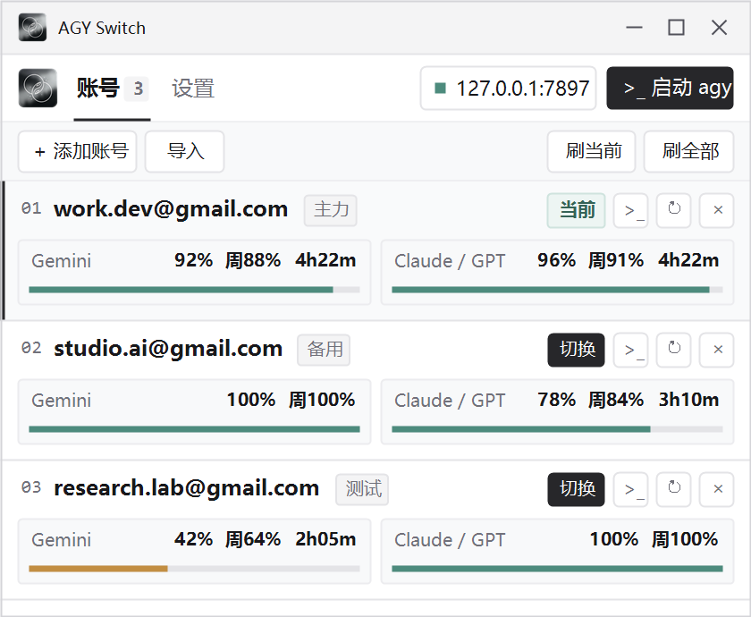
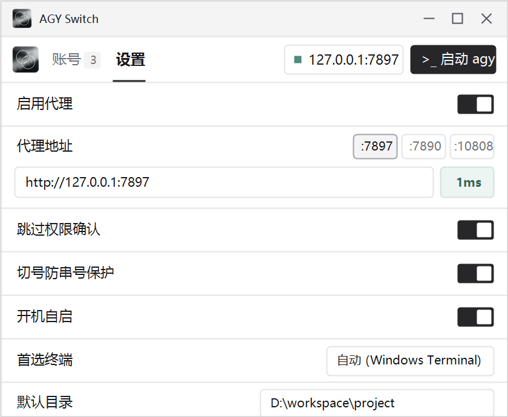

<div align="center">
  
  <h1>AGY Switch</h1>
  <p>轻量、跨平台、100% 纯官方流量的 Antigravity CLI 多账号切换托盘工具与代理启动器</p>
  <p>
    <a href="https://github.com/Circleee/agy-switch/actions"></a>
    
    
    
  </p>
</div>

---

## 界面预览

| 账号管理与双组实时配额 | 代理端口测速与启动配置 |
| :---: | :---: |
|  |  |

---

## 核心特性

- **极简系统托盘常驻 (`agy-switch`)**
  - 常驻 Windows 右下角托盘 / macOS 顶部状态栏，体积仅 ~10MB（单文件原生运行，零外部依赖）。
  - **右键原生快捷菜单**：1 键切换账号、查看各号余量百分比、快速开关代理、拉起 `agy` / `agy -c` 会话、刷新实时余量。
  - **左键轻量面板**：紧凑现代 Web 控制台布局，双列并排展示 `Gemini` 与 `Claude / GPT` 的 `5h` / `周限额` 进度与重置倒计时；关闭窗口自动最小化回托盘。
- **最高账号安全原则（零第三方流量）**
  - **不自建第三方 OAuth / 不走非官方 HTTP 栈**：新增账号直接编排正版 `agy` 拉起浏览器完成 Google 官方原生授权，中途取消自动无损回滚原账号。
  - **5 路官方凭证强一致原子切换**：切号时同步更新 **OS 原生钥匙串 (`gemini:antigravity`)** 与 `~/.gemini` 下 4 个凭证文件，并在切走前自动回存正版 `agy` 静默续期后的最新 Token。
  - **不篡改本机设备标识 + 防并发串号保护**：保持本机真实 `installation_id` 不变；切号前自动检测运行中的 `agy` 进程并提示确认。
- **跨平台命令行启动器 (`agyc`)**
  - 同一套 Go 核心库编译出 `3MB` 级 `agyc` 原生命令行工具，在 `pwsh`、`cmd`、`bash`、`zsh` 下通用，并与桌面托盘实时双向同步状态。
- **无缝迁移旧工具数据**
  - 支持从 `~/.antigravity_tools` **一键只读导入**已有账号与配额缓存，不改动原目录数据。

---

## 下载与安装

### 1. 直接下载可执行文件与安装包
前往 [**Releases 最新版本**](https://github.com/Circleee/agy-switch/releases/latest) 直接下载：

| 平台 | 推荐下载 | 说明 |
| :--- | :--- | :--- |
| **Windows (`x64`)** | [**agy-switch.exe**](https://github.com/Circleee/agy-switch/releases/latest/download/agy-switch.exe) · [**agyc.exe**](https://github.com/Circleee/agy-switch/releases/latest/download/agyc.exe) · [整合压缩包 (.zip)](https://github.com/Circleee/agy-switch/releases/latest/download/AGY-Switch-Windows-amd64.zip) | 双击 `agy-switch.exe` 即可常驻右下角托盘 |
| **macOS (`Apple Silicon & Intel`)** | [**AGY-Switch-macOS-universal.dmg**](https://github.com/Circleee/agy-switch/releases/latest/download/AGY-Switch-macOS-universal.dmg) · [压缩包 (.zip)](https://github.com/Circleee/agy-switch/releases/latest/download/AGY-Switch-macOS-universal.zip) | 拖入 `/Applications` 使用 |

> macOS 首次打开若提示系统安全拦截（未公证），在终端执行一行即可放行：
> ```bash
> xattr -cr /Applications/agy-switch.app
> ```

### 2. 注册命令行 `agyc` 到系统 PATH（Windows 一键脚本）
```powershell
powershell -ExecutionPolicy Bypass -File .\scripts\install.ps1 -LaunchTray
```
> 若旧版 PowerShell `$PROFILE` 中曾定义过同名 `function agyc`，可附加 `-DisableProfileFunctions` 自动备份原配置文件后注释旧函数，使原生 `agyc.exe` 优先生效。

---

## `agyc` 命令行用法

| 命令 | 说明 |
| :--- | :--- |
| `agyc` | 以当前激活账号 + 已配置的代理端口直接启动 `agy` |
| `agyc -c` | 以当前账号继续上次对话 (`agy --continue`) |
| `agyc <序号\|邮箱> [参数...]` | 5 路凭证原子切号后立即启动（如 `agyc 1`、`agyc 2 -c`） |
| `agyc -u <备注\|前缀> [参数...]` | 按备注名或邮箱前缀切号后启动（如 `agyc -u work -c`） |
| `agyc -all` | 毫秒级读取本地缓存，打印彩色多账号配额进度条总览 |
| `agyc -realall` | 串行调用正版 `agy /usage` 实时拉取全部账号余量，结束后自动恢复原号 |
| `agyc list` / `agyc current` | 列出已纳管账号 / 检查当前 5 路凭证同步健康状态 |
| `agyc switch <目标> [--force]` | 仅切换当前激活账号，不启动终端会话 |
| `agyc import` | 从 `~/.antigravity_tools` 只读导入现有账号与缓存 |
| `agyc panel` | 唤醒或启动后台托盘主面板窗口 |
| `agyc --no-proxy [参数...]` | 本次临时跳过代理直连启动 `agy` |

---

## 本地源码编译

环境要求：`Go 1.24+`、`Node.js 20+`、`Wails CLI v2.11+`（`go install github.com/wailsapp/wails/v2/cmd/wails@v2.11.0`）。

### Windows
```powershell
powershell -ExecutionPolicy Bypass -File .\scripts\build.ps1
```

### macOS / Linux
```bash
cd frontend && npm install && npm run build && cd ..
wails build -clean
go build -trimpath -ldflags="-s -w" -o build/bin/agyc ./cmd/agyc
```

---

## 目录结构

```text
agy-switch/
├── main.go / app.go               # Wails 桌面容器入口、单实例回环唤醒与前后端绑定
├── cmd/agyc/                      # 跨平台 agyc 命令行启动器
├── internal/
│   ├── store/                     # ~/.agy-switch 状态与多账号快照原子存储
│   ├── creds/                     # OS Keyring + ~/.gemini 4 文件强一致同步与旧数据导入
│   ├── agy/                       # 官方登录引导回滚、/usage 解析、代理测速与终端拉起
│   ├── tray/                      # Windows 原生 Win32 托盘 & macOS/Linux 系统托盘适配
│   └── ipc/                       # CLI 与桌面托盘状态实时通知服务
└── frontend/                      # React + TypeScript 轻量控制面板
```
